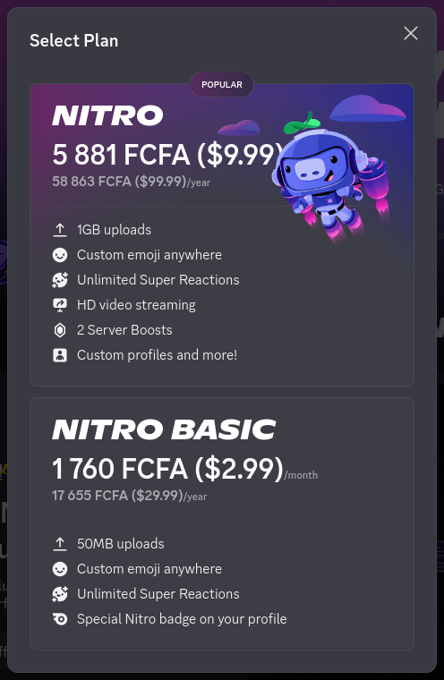

## Convertisseur FCFA

**Résumé**  
Convertit automatiquement les montants affichés en dollars, euros, livres et autres devises en FCFA, sur toutes les pages web. Fini les conversions à la main sur les pages de facturation.

**Description (FR)**  
Convertisseur FCFA remplace automatiquement les prix affichés en devises étrangères par leur valeur en FCFA, directement dans la page.

Pratique pour les pages de facturation, les abonnements, les boutiques en ligne et les paiements qui n'affichent que du dollar ou de l'euro.

**Exemples**

<table>
  <tr>
    <td align="center">
       
      Discord
    </td>
    <td align="center">
       
      Roblox
    </td>
  </tr>
  <tr>
    <td align="center">
       
      Amazon
    </td>
  </tr>
</table>

**Fonctionnalités** 
- Conversion automatique de tous les montants de la page, y compris ceux qui apparaissent après le chargement
- Une trentaine de devises reconnues : USD, EUR, GBP, CAD, AUD, CHF, JPY, NGN, GHS, MAD, ZAR, etc.
- Formats de nombres courants : 1,234.56 / 1.234,56 / 1 234,56
- Affichage au choix : FCFA seul, ou FCFA avec le montant d'origine entre parenthèses
- Le symbole $ peut désigner USD, CAD, AUD ou NZD
- Taux mis à jour automatiquement. Pour l'euro, la parité fixe officielle est utilisée (1 EUR = 655,957 FCFA)

**Confidentialité** 
- Aucune donnée personnelle collectée, aucun suivi, aucune publicité
- La seule requête réseau sert à récupérer les taux de change. Aucune information sur les pages visitées n'est envoyée
- L'accès aux pages est nécessaire pour lire et remplacer les prix. Tout le traitement se fait localement dans votre navigateur

**À savoir** 
- Les taux sont indicatifs. Votre banque ou le marchand applique son propre taux et ses frais, donc le montant réellement débité peut différer
- Les montants dont les chiffres sont répartis dans plusieurs éléments de la page peuvent ne pas être détectés
- Vous pouvez désactiver la conversion à tout moment depuis l'icône de la barre d'outils

**Taux de change fournis par ExchangeRate-API : https://www.exchangerate-api.com**
**Exchange rates provided by ExchangeRate-API: https://www.exchangerate-api.com**
